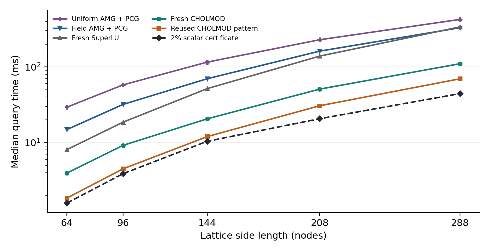

# When a stiffness query can stop before a point solve

Vedant Thaker  
Independent Researcher, Jeffersonville, Indiana, USA  
vedant.thaker1602@gmail.com

Numerical benchmark · November 24, 2026

### Abstract

Whether to factor a cut spring network depends on what the caller needs. On a 42,848-unknown network, classical trial-energy bounds settled 854 of 1,024 decisions about whether the response exceeded the uniform-network value. Those bounds alone reached 2% relative accuracy on none of 48 strong fields in a separate value-estimation panel. For eight additional strong fields, a certified scalar estimate took 244.4 ms in total, including setup, against 283.5 ms for full solves with reused-pattern Cholesky. For the first field alone, Cholesky was faster (71.9 versus 91.9 ms). The scalar method first recovered its setup cost on the fourth field in seed order. The benchmark quantifies the cost of these two requested outputs under a fixed load and prescribed cut.

## A value or a threshold decision

Single-bond changes in elastic networks can substantially alter a global response [1]. Here the quantity of interest is local. For a cut of prescribed length and location, how much elastic energy is released per squared pre-cut force in the next bond? One user may ask for that number to 2% relative accuracy. Another may count the fraction of random stiffness fields for which it exceeds the uniform-network value. A 2%-accurate answer near the reference can fall on its wrong side. A wide interval far from the reference can settle the decision immediately.

Consider an n × n square network of scalar, nearest-neighbor springs at unit spacing. The two grip rows have prescribed displacement, and the lateral edges are free. Across the horizontal midline, remove the n/4 leftmost vertical bonds (n divisible by four), then release one further tip bond of unit stiffness. Let K be the positive-definite stiffness matrix of the remaining free nodes after this cut, and h its signed unit dipole at the tip endpoints. Under fixed grips, removing the tip releases its stored energy plus the relaxation energy of the surviving network. For nonzero pre-cut tip force F, these are F²/2 and F²hᵀK⁻¹h/2. Thus the normalized release E equals (1 + R)/2, where R = hᵀK⁻¹h. The unit stiffness fixes the scale. The index n measures specimen size at fixed spacing. A separate dense assembly solved displacement-controlled equilibria before and after removing the tip. Across three small sizes and three stiffness patterns, the measured energy loss divided by the squared tip force agreed with the dipole calculation within 10⁻¹¹ relative error.

## What a uniform solve buys

Preprocessing can pay off when thousands of parameter queries share a geometry [2]. Factor the uniform post-cut matrix K₀ once. Write x₀ = K₀⁻¹h and R₀ = hᵀx₀. For bond incidence bₑ, the nonnegative weights wₑ = (bₑᵀx₀)²/R₀ sum to one. Use the uniform-network potential and flow as admissible trial fields in the Dirichlet and Thomson principles [3]. For stiffness vector k this gives (1 + R₀/Σₑwₑkₑ)/2 ≤ E ≤ (1 + R₀Σₑwₑ/kₑ)/2. For 0 < L ≤ E ≤ U, returning √(LU) incurs at most √(U/L) − 1 relative error. To classify E, compare both endpoints with the reference.

When only 16 known bonds change, cache H = BᵀK₀⁻¹B and f = Bᵀx₀ for their incidence columns B. With diagonal stiffness changes Δ, Woodbury gives R = R₀ − fᵀ(I + ΔH)⁻¹Δf [4]. Rank one is the Sherman–Morrison special case. For a distributed change on 86,059 bonds, a dense matrix with one double-precision entry per changed-bond pair alone would occupy about 55 GiB. The benchmark uses this classical update only for the stipulated 16-bond support.

For general fields, start preconditioned conjugate gradient (PCG) at x₀ and apply K₀⁻¹ as preconditioner [5]. One variant targets relative residual 10⁻¹⁰. Another stops for the requested scalar output. For an iterate x set r = h − Kx and L = (1 + 2hᵀx − xᵀKx)/2. The unaccounted energy equals rᵀK⁻¹r/2. Since K ≥ kₘᵢₙ K₀ in quadratic-form order, U = L + rᵀK₀⁻¹r/(2kₘᵢₙ) bounds E from above. The stopping test recomputes the true residual before recording the interval. This certificate assumes exact arithmetic. The numerical checks below use a tolerance of 10⁻⁹.

## A direct comparison on identical fields

The local family varies the 16 nearest surviving bonds to the tip independently, log-uniformly between 1/4 and 4. Distributed fields start with unit normal noise on the nodes, smoothed at three lattice spacings. Each bond takes its high or low stiffness according to the sign of the sum at its endpoints. Paired maps give mild values 0.8 and 1.25, or strong values 0.25 and 4. These laws define computational loads. No material has been fitted to them.

Five sizes have 3,968 to 82,368 free nodes. At each size, eight seed indices generated fields in each family. Six methods ran in randomized order on each field. The two direct CHOLMOD configurations use supernodal LLᵀ [6]. One orders and factorizes each field from scratch. The other retains its symbolic factor and lower-triangle layout, then replaces the values and refactorizes. Fresh SuperLU uses its default sparse ordering. Classical Ruge–Stüben algebraic multigrid (AMG) in PyAMG [7] preconditions CG, either through a newly built hierarchy per field or through one hierarchy built on uniform stiffness. Both use symmetric Gauss–Seidel smoothing, V-cycles and a relative residual tolerance of 10⁻¹⁰. Those five methods solve for the full displacement vector.

The sixth method only guarantees the scalar response to 2%. It tries the trial-field interval before assembly, then, when necessary, advances PCG using a uniform Cholesky factor until the residual interval is narrow enough. Both iterative multigrid methods start from zero; the certified iteration starts from the uniform solution paid for during setup. Single-thread timings include per-field assembly, required representation changes, factorization or hierarchy construction, and solution. Timing excludes field generation, shared geometry and reusable setup. The supplement records field-generation seeds and every method timing.

At n = 208 both reusable solvers incurred 19.2 ms for geometry and 1.6 ms for uniform assembly. The additional setup took 19.9 ms for the Cholesky pattern and 52.3 ms for the certificate, a difference of 32.4 ms. Median strong-field query times after setup were 30.7 and 20.7 ms, respectively (Table 1). In ascending seed order the first three fields still favored Cholesky (133.9 versus 143.6 ms including setup). After the fourth the totals were 164.4 versus 161.9 ms. After eight the scalar method saved 39.1 ms, or 13.8% of total Cholesky time when both start from scratch. At n = 64 the eight strong fields together did not recover the scalar method’s setup cost. A threshold or tolerance that admits a trial field changes the economics: on the mild fields at n = 208 the scalar method took a median 0.17 ms per query.

| Method | n = 64 | n = 96 | n = 144 | n = 208 | n = 288 |
| --- | --- | --- | --- | --- | --- |
| Fresh LU | 8.1 (1.2) | 18.6 (1.8) | 51.7 (2.7) | 138.8 (7.7) | 337.8 (36.5) |
| Fresh Cholesky | 4.0 (0.3) | 9.2 (0.7) | 20.6 (3.0) | 50.9 (2.9) | 110.3 (8.9) |
| Reused Cholesky | 1.8 (0.1) | 4.5 (0.4) | 12.0 (1.7) | 30.7 (1.0) | 69.7 (3.6) |
| Field AMG | 14.9 (1.6) | 31.9 (3.6) | 69.8 (4.5) | 161.5 (13.6) | 329.4 (21.9) |
| Uniform AMG | 29.3 (6.1) | 57.9 (4.0) | 115.8 (4.2) | 228.4 (13.6) | 424.2 (17.9) |
| 2% scalar | 1.6 (0.4) | 3.9 (0.9) | 10.4 (2.0) | 20.7 (3.0) | 44.4 (3.2) |
Table 1. Median query time after setup in milliseconds, with interquartile width (75th minus 25th percentile) in parentheses. Each cell contains eight strong fields. Quartiles use linear interpolation. The point solvers return the full vector. The last row targets the scalar response to 2% relative accuracy.

Of the 40 strong-field comparisons in Table 1, the certified result was faster than reused-pattern Cholesky in 35, including all eight at each of the two largest sizes. The iterative AMG methods cost more than reused-pattern Cholesky at every size on median. At n = 288, building a fresh hierarchy reduced median CG iterations from 46.5 to 24 relative to uniform reuse. The medians of the phase times and individual paired timings are available in the supplement. On all 120 fields, the five full-solve responses differed from SuperLU by at most 1.9 × 10⁻¹⁴ in relative terms. The largest observed certified-estimate error was 1.478%.

The storage tradeoff differs from the latency ranking. For one strong field at n = 288 the exported Cholesky L arrays occupied 53.6 MiB, the exported SuperLU L and U arrays 90.0 MiB, and the sparse operators and transfers in the nine AMG levels 18.4 MiB. These array totals use the actual index widths of each binding. Process workspaces, symbolic data, transient allocations and coarse dense factors are excluded. They do not establish peak memory use.

## Classifying a threshold

A 48-field-per-family accuracy panel at each of n = 64 and 208 found that the trial interval alone met the 2% point-value criterion on all mild distributed fields and on no local or strong fields. On the local fields, the known-support Woodbury update matched the direct value to roundoff. This rank-16 calculation illustrates the benefit of knowing which bonds vary; the update identity is classical [4].

At n = 208 the uniform threshold is E₀ = 1.2059805. A separate timing panel used 1,024 further seed indices in each family. The localized queries used Woodbury. Distributed queries invoked the certified iteration only if the trial interval touched the threshold. Each field was timed with both uniform-factor choices and a full reused-pattern Cholesky solve. The direct comparator reused its ordering but assembled and refactorized the field matrix for every query. A seeded permutation randomized the field order and the method order within each field. Both threshold pipelines agreed on every decision with the 3,072 full solves. For the 96 fields with an archived direct SuperLU check, the full Cholesky responses also agreed within numerical tolerance.

| Field family | Above E₀ / 1,024 | PCG fallbacks | Screen + Cholesky (s) | Screen + LU (s) | Full Cholesky (s) |
| --- | --- | --- | --- | --- | --- |
| 16 local | 555 | 0 | 0.086 | 0.084 | 25.223 |
| Distributed mild | 508 | 33 | 0.627 | 0.930 | 24.962 |
| Distributed strong | 532 | 170 | 2.821 | 4.619 | 24.910 |
Table 2. Total query time for 1,024 matched fields per family. The first two timings use the indicated uniform factor for Woodbury or screened PCG. The last column refactorizes and solves every field, including those settled by an interval. All three columns were measured in the same timing run. Generation, common geometry, uniform assembly and one-time setup are excluded.

Shared geometry and uniform assembly took 68.4 and 1.2 ms, respectively. Additional setup was 94.2 ms for the Cholesky-screen pipeline, 180.4 ms for its LU counterpart and 18.2 ms for the direct symbolic factor. Across all 3,072 queries, adding shared preparation and each method’s setup once gives 3.698 s, 5.883 s and 75.182 s, respectively. Both screened pipelines prepared the 16-bond Woodbury cache once for the whole three-family workload. Table 1 used an Intel Xeon Platinum 8573C host and omitted that cache. Table 2 used an AMD EPYC 9V74. Absolute times should be compared within each table. On strong fields the trial interval settled 854 threshold decisions without iteration. The same trial bounds met the point-value tolerance on none of the 48 strong fields in the accuracy panel. Width controls the value request; distance from the reference controls the threshold request. The Monte Carlo standard error for the modeled exceedance fraction is about 0.016. Acceptance fractions depend on the field law, cut geometry and reference.

## Limits of the timing comparison

These are finite, two-dimensional scalar networks with fixed physical spacing, a prescribed cut and one load vector. Timing on a shared host, library versions, ordering, implementation overhead and multigrid tuning all affect the measurements. Five sizes show the observed scaling range. They cannot establish an asymptotic complexity law, a faster solver on three-dimensional systems, or a prediction of physical crack growth. A user who needs the full solution cannot substitute the scalar certificate.

## Data and code availability

The supplement includes scripts, environment locks, source checks and machine-readable results. The five-size comparison has 720 timed method–field records. The accuracy panel has 288 field records. The paired threshold panel includes 3,072 fields, with both certified intervals and the full Cholesky response recorded for each. All fields can be regenerated from the published seeds.

Use the accompanying study directory to rerun `verify_scaling.py` and `verify_threshold_compare.py`. Individual timings and one-time costs are in `scaling_fields.csv` and `scaling_setup.csv`. The public project is <https://github.com/VEDANT1602/lattice-fracture-calibration>.

## Author and disclosures

Vedant Thaker is the sole author. He specified the solver-selection question, the larger-scale direct and multigrid comparisons, and the matched Cholesky threshold benchmark. OpenAI Codex assisted with the derivations, implementation, benchmark execution, numerical cross-checks and manuscript drafting.

This research received no specific grant from any funding agency in the public, commercial, or not-for-profit sectors. The author declares no competing interests.

## References

[1] D. Hexner, A. J. Liu and S. R. Nagel. Linking microscopic and macroscopic response in disordered solids. Physical Review E 97, 063001 (2018). <https://doi.org/10.1103/PhysRevE.97.063001>

[2] G. Rozza, D. B. P. Huynh and A. T. Patera. Reduced Basis Approximation and a Posteriori Error Estimation for Affinely Parametrized Elliptic Coercive Partial Differential Equations: Application to Transport and Continuum Mechanics. Archives of Computational Methods in Engineering 15, 229–275 (2008). <https://doi.org/10.1007/s11831-008-9019-9>

[3] A. Nachmias. Random Walks and Electric Networks. In Planar Maps, Random Walks and Circle Packing, Lecture Notes in Mathematics 2243, 11–31 (2020). <https://doi.org/10.1007/978-3-030-27968-4_2>

[4] H. V. Henderson and S. R. Searle. On Deriving the Inverse of a Sum of Matrices. SIAM Review 23(1), 53–60 (1981). <https://doi.org/10.1137/1023004>

[5] R. Barrett, M. Berry, T. F. Chan, J. Demmel, J. Donato, J. Dongarra, V. Eijkhout, R. Pozo, C. Romine and H. van der Vorst. Templates for the Solution of Linear Systems: Building Blocks for Iterative Methods. SIAM (1994). <https://doi.org/10.1137/1.9781611971538>

[6] Y. Chen, T. A. Davis, W. W. Hager and S. Rajamanickam. Algorithm 887: CHOLMOD, Supernodal Sparse Cholesky Factorization and Update/Downdate. ACM Transactions on Mathematical Software 35(3), article 22 (2008). <https://doi.org/10.1145/1391989.1391995>

[7] N. Bell, L. N. Olson and J. Schroder. PyAMG: Algebraic Multigrid Solvers in Python. Journal of Open Source Software 7(72), 4142 (2022). <https://doi.org/10.21105/joss.04142>
